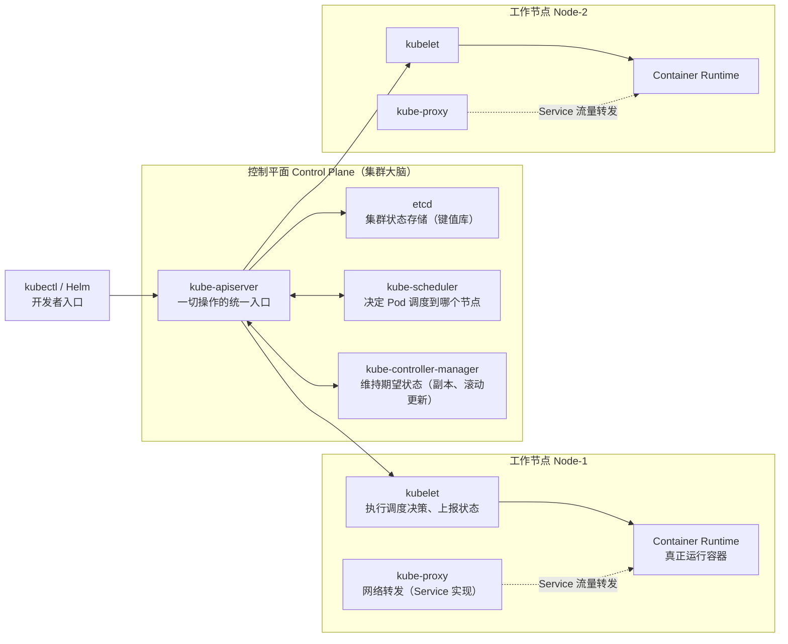
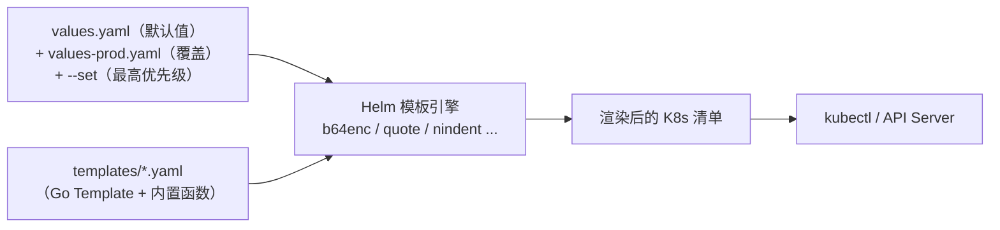
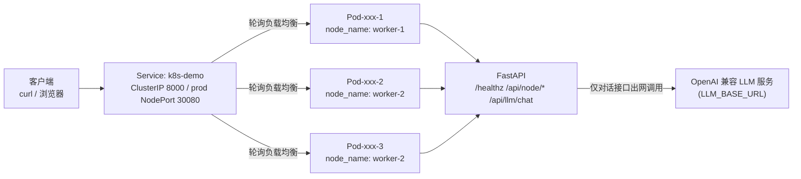
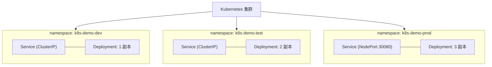
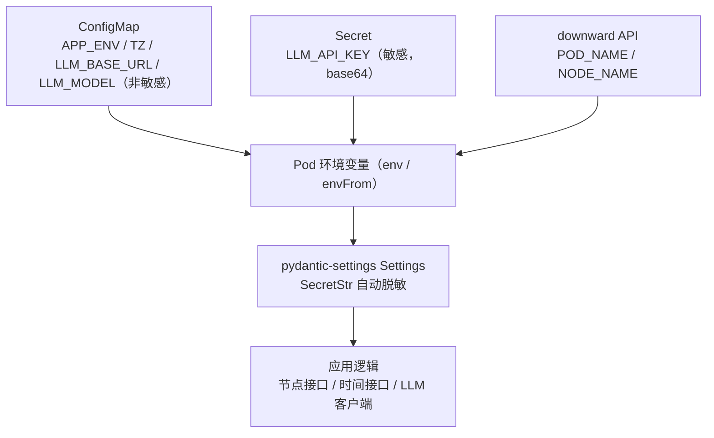
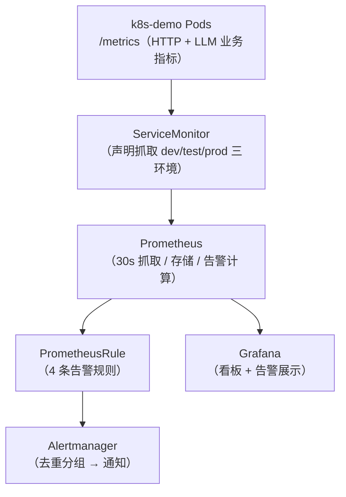

# k8s-demo：FastAPI + Kubernetes + Helm 教学示例

一个刻意保持简单、但覆盖真实生产实践的演示项目：用 **FastAPI** 写应用，用 **uv** 管理依赖，
分别以 **本地 / Docker Compose / Kubernetes（kustomize）/ Helm** 四种方式部署，
并完整演示 **dev / test / prod 三环境配置隔离**与**敏感信息（API Key）的安全注入**。

本项目适合作为学习 Kubernetes 与 Helm 的第一站：你可以先在本地把接口跑起来，
再用 K8s 部署 3 个副本，反复请求 `/api/node/name` 直观感受 Service 负载均衡，
最后用 Helm 一条命令完成带环境差异的生产部署。

## 目录

- [功能与接口](#功能与接口)
- [多环境配置矩阵](#多环境配置矩阵)
- [快速开始](#快速开始)
  - [0. 前置要求](#0-前置要求)
  - [1. 本地运行（uv）](#1-本地运行uv)
  - [2. Docker Compose 部署](#2-docker-compose-部署)
  - [3. Kubernetes 原生部署（kustomize）](#3-kubernetes-原生部署kustomize)
  - [4. Helm 一键部署](#4-helm-一键部署)
- [K8s 核心架构组件介绍](#k8s-核心架构组件介绍)
- [Helm 核心概念介绍](#helm-核心概念介绍)
- [项目逻辑架构说明](#项目逻辑架构说明)
- [敏感信息规范](#敏感信息规范)
- [集群监控（Prometheus）](#集群监控prometheus)
- [常用命令速查表](#常用命令速查表)

---

## 功能与接口

| 接口 | 方法 | 说明 |
|---|---|---|
| `/` | GET | 应用简介与入口引导 |
| `/healthz` | GET | 健康检查（K8s 探针入口），返回 `{"status":"ok","app_env":"dev"}` |
| `/api/node/name` | GET | 返回当前 Pod 名与调度节点名（downward API 注入） |
| `/api/node/time` | GET | 返回容器系统时间与生效时区 |
| `/api/llm/chat` | POST | LLM 对话（OpenAI 兼容协议，支持流式 SSE） |
| `/chat` | GET | **LLM 对话测试页**：多轮对话、流式/非流式切换、模型覆盖 |
| `/metrics` | GET | **Prometheus 指标**：HTTP 请求指标 + LLM 业务指标（见「集群监控」章节） |
| `/docs` | GET | FastAPI 自动生成的交互式 API 文档 |

### LLM 对话接口

应用使用官方 `openai` SDK 的 `AsyncOpenAI(base_url=..., api_key=...)`，
任何 **OpenAI 兼容服务**只需替换 `LLM_BASE_URL` 即可接入：

| 服务 | LLM_BASE_URL 示例 |
|---|---|
| OpenAI | `https://api.openai.com/v1` |
| DeepSeek | `https://api.deepseek.com/v1` |
| 通义千问 | `https://dashscope.aliyuncs.com/compatible-mode/v1` |
| 本地 Ollama | `http://host.docker.internal:11434/v1` |

请求示例（非流式）：

```bash
curl -X POST http://localhost:8000/api/llm/chat \
  -H "Content-Type: application/json" \
  -d '{"messages": [{"role": "user", "content": "用一句话介绍 Kubernetes"}]}'
```

```json
{"reply": "Kubernetes 是一个用于自动化部署、扩缩和管理容器化应用的开源平台。",
 "model": "gpt-4o-mini", "elapsed_seconds": 1.234}
```

流式请求（`"stream": true`）返回 SSE（`text/event-stream`）增量数据，演示时可用 `curl -N` 观察逐字输出。
未配置 `LLM_API_KEY` 时该接口返回 502 与可读提示，**不影响**节点类接口。

---

## 多环境配置矩阵

应用通过唯一环境标识 `APP_ENV`（dev/test/prod）区分行为；三种部署方式都按同一矩阵配置：

| 维度 | dev | test | prod |
|---|---|---|---|
| K8s namespace | `k8s-demo-dev` | `k8s-demo-test` | `k8s-demo-prod` |
| 副本数 | 1 | 2 | 3 |
| 日志级别 | DEBUG | INFO | INFO |
| Service 类型 | ClusterIP | ClusterIP | NodePort（30080） |
| 资源限制 | 无 | requests + limits（适度） | requests + limits（完整） |
| 镜像 tag | `latest` | `latest` | `1.0.0`（固定版本） |
| 配置载体 | `.env` / kustomize / values-dev.yaml | `.env` / kustomize / values-test.yaml | `.env` / kustomize / values-prod.yaml |

---

## 快速开始

### 0. 前置要求

- **Python 3.11+ 与 [uv](https://docs.astral.sh/uv/)**（本地运行）
- **Docker**（Compose 部署 / 构建镜像）
- **Kubernetes 集群**：本地推荐 [minikube](https://minikube.sigs.k8s.io/) 或 [kind](https://kind.sigs.k8s.io/)，
  需 `kubectl`；Helm 部署额外需要 [helm](https://helm.sh/)（v3）

### 1. 本地运行（uv）

```bash
# 1. 安装依赖（uv 读取 pyproject.toml + uv.lock，自动准备 Python 3.11）
uv sync

# 2. 准备密钥（.env 已被 gitignore，不会进 git）
cp .env.example .env
#    编辑 .env，填入 LLM_API_KEY 等真实值

# 3. 启动（开发模式，DEBUG 日志 + 热重载）
APP_ENV=dev uv run uvicorn app.main:app --reload

# 4. 验证
curl http://localhost:8000/healthz          # {"status":"ok","app_env":"dev"}
curl http://localhost:8000/api/node/name    # 本地无 K8s：{"pod_name":"unknown",...}
curl http://localhost:8000/api/node/time    # {"time":"2026-11-23T19:43:54+08:00",...}
open http://localhost:8000/chat             # 浏览器打开 LLM 对话测试页
curl http://localhost:8000/metrics          # Prometheus 指标（http_* 与 llm_* 两类）

# 5. 运行测试
uv run pytest
```

启动日志会自动打印生效配置，且密钥已脱敏——这是本项目贯穿所有部署方式的约定：

```
INFO app.main - APP_ENV      = dev
INFO app.main - LLM_BASE_URL = https://api.openai.com/v1
INFO app.main - LLM_API_KEY  = **********（已脱敏，非空=True）
```

### 2. Docker Compose 部署

```bash
# 1. 构建并启动（读取同目录 .env 注入配置，密钥不进入镜像/文件）
cp .env.example .env    # 填入真实值
docker compose up -d --build

# 2. 验证
curl http://localhost:8000/healthz

# 3. 开发模式（源码挂载 + 热重载，改代码即生效）：
docker compose -f docker-compose.yml -f docker-compose.dev.yml up -d

# 4. 停止
docker compose down
```

Compose 的两个文件：
- `docker-compose.yml`：各环境共用的基础定义，`environment` 用 `${VAR:-默认值}` 引用 `.env`；
- `docker-compose.dev.yml`：开发 override（挂载源码 + `--reload` + 强制 `APP_ENV=dev`）。

### 3. Kubernetes 原生部署（kustomize）

原生 YAML 按 kustomize 的 **base + overlays** 结构管理三环境：
`k8s/base/` 放公共清单，`k8s/overlays/{dev,test,prod}/` 只写环境差异。
`kubectl apply -k` 是 kubectl 内置能力，无需额外安装。

```bash
# 1. 构建镜像（minikube 用户先执行：eval $(minikube docker-env)）
docker build -t k8s-demo:1.0.0 -t k8s-demo:latest .

# 2. 每个环境各建各的 Secret（敏感信息不进 git，见「敏感信息规范」）
kubectl create namespace k8s-demo-dev
kubectl -n k8s-demo-dev create secret generic k8s-demo-secret \
  --from-literal=LLM_API_KEY=sk-your-api-key-here

# 3. 部署 dev 环境（test/prod 同理，替换目录与 namespace）
kubectl apply -k k8s/overlays/dev
kubectl apply -k k8s/overlays/test
kubectl apply -k k8s/overlays/prod

# 4. 观察部署（-o wide 显示 NODE 列，与 /api/node/name 对照）
kubectl -n k8s-demo-prod get pods -o wide

# 5. 本地访问（prod 也可直接走 NodePort 30080）
kubectl -n k8s-demo-prod port-forward svc/k8s-demo 8000:8000
curl http://localhost:8000/api/node/name

# 6. 反复请求验证负载均衡（3 个副本轮询，pod_name 会变化）
for i in 1 2 3 4 5 6; do curl -s http://localhost:8000/api/node/name; echo; done

# 7. 变更预览（渲染结果比对，不触碰集群）
kubectl diff -k k8s/overlays/prod

# 8. 清理
kubectl delete -k k8s/overlays/dev
kubectl delete -k k8s/overlays/test
kubectl delete -k k8s/overlays/prod
```

### 4. Helm 一键部署

Helm 用「一份 Chart + 三份 values 覆盖文件」管理环境，
并额外提供 release 生命周期能力（升级、回滚、卸载）：

```bash
# 0. 检查 Chart 语法
helm lint helm/k8s-demo

# 1. 渲染预览（只看最终 YAML，不触碰集群 —— 学习 Helm 的神器）
helm template k8s-demo-dev helm/k8s-demo -f helm/k8s-demo/values-dev.yaml
helm template k8s-demo-prod helm/k8s-demo -f helm/k8s-demo/values-prod.yaml

# 2. 安装 prod（--set 注入密钥，最高优先级，不落盘）
helm install k8s-demo-prod helm/k8s-demo \
  -n k8s-demo-prod --create-namespace \
  -f helm/k8s-demo/values-prod.yaml \
  --set llm.apiKey=sk-your-api-key-here

# 3. 同样方式安装 dev / test
helm install k8s-demo-dev helm/k8s-demo -n k8s-demo-dev --create-namespace \
  -f helm/k8s-demo/values-dev.yaml --set llm.apiKey=sk-your-api-key-here

# 4. 查看所有环境 release 与访问提示
helm list -A
kubectl -n k8s-demo-prod port-forward svc/k8s-demo-prod-k8s-demo 8000:8000

# 5. 升级（改 values 或镜像 tag 后）
helm upgrade k8s-demo-prod helm/k8s-demo -n k8s-demo-prod \
  -f helm/k8s-demo/values-prod.yaml --reuse-values

# 6. 回滚到上一版本
helm rollback k8s-demo-prod 1 -n k8s-demo-prod

# 7. 卸载
helm uninstall k8s-demo-prod -n k8s-demo-prod
```

**values 合并优先级**（从高到低）：`--set` > `-f values-prod.yaml` > `values.yaml` 默认值。
安装完成后 Helm 会输出 NOTES 指引（含密钥未配置时的警告与补配命令）。


---

## K8s 核心架构组件介绍

### 集群整体架构

一个 Kubernetes 集群由**控制平面（Control Plane）**与若干**工作节点（Node）**组成。
你永远不会直接操作节点，而是通过 `kubectl` 向 API Server 提交**期望状态**，
集群内的控制器自动把实际状态调整到与期望一致（声明式运维的核心思想）。



### 控制平面组件

| 组件 | 职责 | 类比 |
|---|---|---|
| `kube-apiserver` | 一切操作的统一入口：`kubectl`、Helm、控制器都只与它对话；认证、鉴权、校验 | 公司前台 |
| `etcd` | 分布式键值库，保存集群全部期望状态；是集群的"唯一事实来源" | 数据库 |
| `kube-scheduler` | 监听未调度的 Pod，根据资源、亲和性等策略挑选最合适的节点 | 排班系统 |
| `kube-controller-manager` | 运行各种控制器（Deployment、ReplicaSet 等），持续把实际状态推向期望状态 | 自动纠偏的管家 |

### 工作节点组件

| 组件 | 职责 |
|---|---|
| `kubelet` | 每个节点上的"代理"：接收调度结果、启动/停止容器、上报健康状态 |
| `kube-proxy` | 维护网络规则（iptables/IPVS），实现 Service 的虚拟 IP 与负载均衡 |
| `Container Runtime` | 真正运行容器的引擎（containerd、CRI-O 等） |

### 核心资源对象（对照本项目文件）

| 资源 | 是什么 | 本项目对应文件 |
|---|---|---|
| **Pod** | 最小调度单位，一个 Pod 内可含多个容器共享网络/IP | `k8s/base/deployment.yaml` 的 `template` |
| **Deployment** | 声明式管理 Pod 副本、滚动更新、回滚 | `k8s/base/deployment.yaml` |
| **Service** | 给易变的 Pod 提供稳定虚拟 IP 与 DNS 名，并按标签负载均衡 | `k8s/base/service.yaml` |
| **ConfigMap** | 非敏感配置（明文可读） | `k8s/base/configmap.yaml` |
| **Secret** | 敏感配置（base64 编码存储，非加密） | `kubectl create secret` 手动创建 |
| **Namespace** | 资源隔离边界；本项目 dev/test/prod 各占一个 | `kustomization.yaml` 的 `namespace` |

### downward API：应用如何知道"我在哪"

Pod 是 K8s 动态创建的，应用如何知道自己的名字、所在节点？
答案不是去查集群 API，而是 **downward API**——在 Pod 创建时把元数据注入环境变量：

```yaml
env:
  - name: POD_NAME          # 注入 Pod 名（metadata.name）
    valueFrom:
      fieldRef:
        fieldPath: metadata.name
  - name: NODE_NAME         # 注入调度节点名（spec.nodeName）
    valueFrom:
      fieldRef:
        fieldPath: spec.nodeName
```

本项目 `/api/node/name` 返回的 `pod_name`（容器内 `HOSTNAME`）与 `node_name`（`NODE_NAME` 环境变量）正来源于此。
反复请求该接口看到不同 Pod 名，就是 Service 负载均衡的直观证据；
再用 `kubectl get pods -o wide` 对照 NODE 列，即可完成"接口 → Pod → 节点"的完整链路验证。

### 探针（Probe）

本项目 `livenessProbe` 与 `readinessProbe` 都指向 `/healthz`，两者语义不同：

| 探针 | 失败后果 | 用途 |
|---|---|---|
| readinessProbe | Pod 摘除流量（不重启） | 应用启动慢时防止过早接流量；依赖故障时隔离 |
| livenessProbe | Pod 被杀掉重建 | 应用死锁等无法自愈场景的兜底 |

---

## Helm 核心概念介绍

### 三大概念

| 概念 | 含义 | 本项目示例 |
|---|---|---|
| **Chart** | 打包好的 K8s 资源模板集（含 values 默认值、模板、说明） | `helm/k8s-demo/` |
| **Release** | Chart 在集群中的一次安装实例，拥有独立生命周期（install/upgrade/rollback/uninstall） | `k8s-demo-dev`、`k8s-demo-test`、`k8s-demo-prod` 三个 release |
| **Repository** | Chart 的集中托管仓库（类似 Docker Registry） | 本项目直接用本地 Chart 路径 |

### 模板渲染机制

Helm 的安装本质是一次**模板渲染 + kubectl apply**：



学习技巧：`helm template` / `helm install --dry-run --debug` 可以**只看渲染结果、不触碰集群**，
是理解 Chart 与排错最有效的手段。

### Chart 目录结构（对照本项目）

| 文件 | 作用 |
|---|---|
| `Chart.yaml` | Chart 元数据（名称、版本、appVersion） |
| `values.yaml` | 所有可配置项的默认值 |
| `values-{dev,test,prod}.yaml` | 各环境的覆盖值（只写与默认值的差异） |
| `templates/_helpers.tpl` | 命名与标签的约定（`fullname`/`labels`/`selectorLabels`），供所有模板复用 |
| `templates/deployment.yaml` | Deployment 模板（`replicas`、镜像、探针、downward API 均参数化） |
| `templates/service.yaml` | Service 模板（type 在 prod 覆盖为 NodePort） |
| `templates/configmap.yaml` | ConfigMap 模板（非敏感配置） |
| `templates/secret.yaml` | Secret 模板（`LLM_API_KEY` 用 `b64enc` 编码） |
| `templates/NOTES.txt` | 安装成功后打印的指引（含密钥未配置警告） |

> 常见坑：Deployment 的 `selector.matchLabels` 与 Service 的 `selector` 必须严格一致
> （都来自 `_helpers.tpl` 的 `selectorLabels`），否则 Service 选不中 Pod，请求全部失败。

### kustomize vs Helm

本项目同时提供两种 K8s 部署方式，是为了教学对比，实际项目通常二选一：

| 维度 | kustomize（`k8s/`） | Helm（`helm/`） |
|---|---|---|
| 原理 | 声明式 overlay 补丁（纯客户端拼接 YAML） | 模板引擎渲染 + release 生命周期管理 |
| 多环境 | `overlays/{dev,test,prod}` | 多个 values 文件 + 不同 release 名 |
| 状态 | 无状态，不记录安装历史 | 集群中记录 release 历史（可 rollback） |
| 安装 | kubectl 内置（`apply -k`） | 需要单独安装 helm CLI |
| 适合 | 简单、透明、CI/CD 流水线 | 应用分发、参数化打包、生命周期管理 |

---

## 项目逻辑架构说明

### 三层视角

1. **请求流**：客户端 → Service（虚拟 IP）→ 多 Pod 轮询负载均衡 → FastAPI 路由。
2. **配置流**：ConfigMap（非敏感）/ Secret（API Key）/ downward API（Pod、节点名）
   → Pod 环境变量 → pydantic-settings（`SecretStr` 脱敏）→ 应用逻辑。
3. **外部依赖**：Pod 出网调用 OpenAI 兼容 LLM 服务（Base URL 可配置），
   LLM 不可用时仅对话接口降级为 502，不影响节点类接口。

### 部署拓扑与请求流



### 多环境拓扑



### 配置注入流



### 部署方式对照

| 方式 | 命令 | 定位 |
|---|---|---|
| 本地 uv | `uv run uvicorn app.main:app --reload` | 日常开发、调试 |
| Docker Compose | `docker compose up -d`（+ dev override） | 单机部署、模拟容器环境 |
| K8s kustomize | `kubectl apply -k k8s/overlays/<env>` | 集群部署，环境差异靠 overlay |
| Helm | `helm install k8s-demo-<env> ... -f values-<env>.yaml` | 集群部署 + release 生命周期（升级/回滚） |

---

## 敏感信息规范

`LLM_API_KEY` 是本项目唯一的敏感信息。各部署方式的注入路径如下（贯穿原则：**密钥永不进 git，永不写死进镜像**）：

| 部署方式 | 密钥注入 | 说明 |
|---|---|---|
| 本地 uv | `.env` 文件 | `cp .env.example .env` 后填写；`.env` 已被 gitignore |
| Docker Compose | 宿主机 `.env` | compose 的 `environment` 用 `${LLM_API_KEY}` 引用，密钥不写进 compose 文件 |
| K8s（kustomize） | `kubectl create secret` | 每个 namespace 各建各的 Secret；base64 密钥不进入仓库 |
| Helm | `--set llm.apiKey=sk-xxx` | 安装/升级时注入，不落盘；`values.yaml` 中 `apiKey` 恒为空串 |

应用侧配套防护（`app/config.py`）：

- `LLM_API_KEY` 声明为 pydantic `SecretStr`：日志、repr、异常一律输出 `**********`；
- 启动日志只打印非敏感配置（`LLM_BASE_URL`、`LLM_MODEL`），密钥仅打印"是否已配置"。

关于 Secret 的一个常见误解（README 教学重点）：

```bash
# ConfigMap 是明文，一眼可见
kubectl -n k8s-demo-dev get configmap k8s-demo-config -o yaml

# Secret 的值是 base64 编码——注意：编码 ≠ 加密！
kubectl -n k8s-demo-dev get secret k8s-demo-secret -o yaml

# 有权限的人随时可以解码
kubectl -n k8s-demo-dev get secret k8s-demo-secret \
  -o jsonpath='{.data.LLM_API_KEY}' | base64 -d; echo
```

K8s Secret 的价值在于**访问控制（RBAC）与分发机制**，而非加密。
生产环境的密钥管理应配合 Secret Manager（Vault、云 KMS、External Secrets 等）。

---

## 集群监控（Prometheus）

### 分层视角

集群监控按三层组织，从零成本到生产级逐步演进：

| 层次 | 手段 | 本项目状态 |
|---|---|---|
| 应用健康 | liveness / readiness 探针（`/healthz`） | ✅ 已内置 |
| 实时资源 | Metrics Server + `kubectl top` | 集群安装即可用 |
| 指标与告警 | Prometheus + Grafana + Alertmanager | ✅ 应用已暴露 `/metrics` |

### 应用已暴露的指标

`prometheus-fastapi-instrumentator` 自动统计 HTTP 指标，`app/metrics.py` 定义业务指标：

| 指标 | 类型 | 说明 |
|---|---|---|
| `http_requests_total{handler,method}` | Counter | 各接口调用量 |
| `http_request_duration_seconds{handler,method}` | Histogram | 接口延迟分布 |
| `llm_chat_requests_total{model,status}` | Counter | LLM 调用计数；`status` = `success` / `not_configured` / `upstream_error` |
| `llm_chat_duration_seconds{model}` | Histogram | LLM 对话耗时（成败都记录，`status` 标签可区分） |

### 监控架构



### 部署监控栈与抓取配置

```bash
# 1. 安装 kube-prometheus-stack（Prometheus + Grafana + Alertmanager + 常用 exporter）
helm repo add prometheus-community https://prometheus-community.github.io/helm-charts
helm install prometheus prometheus-community/kube-prometheus-stack \
  -n monitoring --create-namespace

# 2. 部署本项目监控清单（ServiceMonitor + PrometheusRule）
kubectl apply -f k8s/monitoring/servicemonitor.yaml
kubectl apply -f k8s/monitoring/prometheusrule.yaml

# 3. 验证抓取目标（应看到三个环境的 target）
kubectl -n monitoring port-forward svc/prometheus-kube-prometheus-prometheus 9090:9090
#    浏览器打开 http://localhost:9090/targets

# 4. 打开 Grafana（默认账号 admin，密码从 Secret 解码）
kubectl -n monitoring get secret prometheus-grafana \
  -o jsonpath='{.data.admin-password}' | base64 -d; echo
kubectl -n monitoring port-forward svc/prometheus-grafana 3000:80
#    浏览器打开 http://localhost:3000，Explore 中即可查询本项目指标
```

### 告警规则一览（k8s/monitoring/prometheusrule.yaml）

| 告警 | 触发条件 | 级别 |
|---|---|---|
| `K8sDemoDown` | `/metrics` 连续 2 分钟抓取失败 | critical |
| `K8sDemoLLMErrorRateHigh` | LLM 非成功调用率 > 30%，持续 5 分钟 | warning |
| `K8sDemoPodRestarting` | Pod 在 15 分钟内发生重启 | warning |
| `K8sDemoReplicasMismatch` | 可用副本 < 期望副本，持续 5 分钟 | critical |

### 常用 PromQL

| 查询 | 含义 |
|---|---|
| `up{service="k8s-demo"}` | 各环境实例存活状态 |
| `sum by (namespace) (rate(llm_chat_requests_total[5m]))` | 各环境 LLM 调用 QPS |
| `rate(llm_chat_requests_total{status!="success"}[5m])` | 各环境 LLM 失败速率 |
| `histogram_quantile(0.95, sum by (le) (rate(llm_chat_duration_seconds_bucket[5m])))` | LLM 对话 P95 延迟 |
| `rate(kube_pod_container_status_restarts_total{namespace=~"k8s-demo-.*"}[15m])` | Pod 重启速率 |

### 更多监控能力

- **日志**：容器日志统一打到 stdout，可接入 Loki（与 Grafana 同栈）或 EFK，
  按 namespace 标签（`k8s-demo-dev` 等）区分环境；
- **外部依赖探测**：LLM 是应用的外部依赖，建议用 blackbox-exporter 定期探测 `LLM_BASE_URL`
  可达性——依赖故障时集群内一切指标都可能"正常"，黑盒探测才能发现；
- **自动扩缩容**：安装 Metrics Server 后，可基于 CPU 指标配置 HPA（见「K8s 核心架构组件介绍」）。

---

## 常用命令速查表

### kubectl 基础（观察与排障）

| 命令 | 作用 | 教学要点 |
|---|---|---|
| `kubectl -n k8s-demo-dev get pods -o wide` | 列出 Pod 及节点 | **`-o wide` 的 NODE 列**与 `/api/node/name` 的 `node_name` 互相对照验证 |
| `kubectl -n k8s-demo-dev describe pod <pod>` | 查看 Pod 详情 | 看调度事件、探针状态、环境变量注入结果 |
| `kubectl -n k8s-demo-dev logs -f <pod>` | 跟踪日志 | 能看到应用启动时打印的脱敏配置摘要 |
| `kubectl -n k8s-demo-dev exec -it <pod> -- sh` | 进入容器 | 可执行 `env \| grep -E "LLM\|NODE"` 直观看注入的环境变量 |
| `kubectl -n k8s-demo-dev get events --sort-by=.lastTimestamp` | 查看事件 | **排障首选**：镜像拉取失败、探针失败都记录在这里 |

### kubectl 应用管理

| 命令 | 作用 | 教学要点 |
|---|---|---|
| `kubectl apply -k k8s/overlays/dev` | 按 kustomize 目录部署 | overlay 自动叠加 namespace/副本数等环境差异 |
| `kubectl diff -k k8s/overlays/prod` | 变更预览 | 提交前先看差异，防止误操作 |
| `kubectl -n k8s-demo-dev get all` | 查看全部资源 | 观察 Deployment/ReplicaSet/Pod/Service 的层级关系 |
| `kubectl -n k8s-demo-dev scale deploy/k8s-demo --replicas=5` | 手动扩容 | 与 Deployment 声明式副本管理的对照实验 |
| `kubectl -n k8s-demo-dev set image deploy/k8s-demo k8s-demo=k8s-demo:1.0.1` | 更新镜像 | 配合 `rollout status` 观察滚动更新过程 |
| `kubectl -n k8s-demo-dev rollout status deploy/k8s-demo` | 等待发布完成 | 滚动更新进度跟踪 |
| `kubectl -n k8s-demo-dev rollout undo deploy/k8s-demo` | 回滚 | 原生回滚能力（Helm 是另一层回滚） |
| `kubectl -n k8s-demo-dev port-forward svc/k8s-demo 8000:8000` | 本地访问调试 | 无需暴露 Service 即可本地联调 |
| `kubectl delete -k k8s/overlays/dev` | 按目录删除 | 与 apply -k 对称 |

### kubectl 配置与敏感信息

| 命令 | 作用 | 教学要点 |
|---|---|---|
| `kubectl -n k8s-demo-dev create secret generic k8s-demo-secret --from-literal=LLM_API_KEY=sk-xxx` | 创建 Secret | 每个环境各建各的；`--from-literal` 避免密钥写进文件 |
| `kubectl -n k8s-demo-dev get configmap k8s-demo-config -o yaml` | 查看 ConfigMap | 明文可读——所以只放非敏感配置 |
| `kubectl -n k8s-demo-dev get secret k8s-demo-secret -o jsonpath='{.data.LLM_API_KEY}' \| base64 -d` | 解码 Secret | 证明 base64 只是编码不是加密 |
| `kubectl config get-contexts` | 查看 kubeconfig 上下文 | 多集群操作前确认"我在操作哪个集群" |

### kustomize

| 命令 | 作用 | 教学要点 |
|---|---|---|
| `kubectl kustomize k8s/overlays/prod` | 渲染预览（不下发） | 学习 overlay 合并结果的最快方式 |
| `kubectl apply -k k8s/overlays/prod` | 部署 | kustomize 是 kubectl 内置能力 |
| `kubectl delete -k k8s/overlays/prod` | 删除 | |

### Helm

| 命令 | 作用 | 教学要点 |
|---|---|---|
| `helm lint helm/k8s-demo` | 语法/规范检查 | 提交 Chart 前必跑 |
| `helm template k8s-demo-prod helm/k8s-demo -f helm/k8s-demo/values-prod.yaml` | 渲染预览（不触碰集群） | **学习/排错神器**，与 kustomize 渲染对照理解 |
| `helm install k8s-demo-prod helm/k8s-demo -n k8s-demo-prod --create-namespace -f helm/k8s-demo/values-prod.yaml --set llm.apiKey=xxx` | 安装 | `-f` 覆盖默认值，`--set` 优先级最高 |
| `helm install ... --dry-run --debug` | 模拟安装 | 输出最终清单与 NOTES，不落集群 |
| `helm list -A` | 查看全部 release | 三个环境三个 release 一目了然 |
| `helm upgrade k8s-demo-prod helm/k8s-demo -n k8s-demo-prod --reuse-values` | 升级 | 改 values 或镜像后滚动更新 |
| `helm rollback k8s-demo-prod 1 -n k8s-demo-prod` | 回滚 | release 生命周期管理的价值所在 |
| `helm uninstall k8s-demo-prod -n k8s-demo-prod` | 卸载 | 注意 Secret 也会一并删除 |
| `helm get values k8s-demo-prod -n k8s-demo-prod` | 查看生效 values | 确认合并后的最终配置 |
| `helm get manifest k8s-demo-prod -n k8s-demo-prod` | 查看部署清单 | 对照渲染结果与集群实际状态 |

---

## 项目结构

```
k8s-demo/
├── app/                      # FastAPI 应用
│   ├── main.py               # 入口：路由注册、/healthz、/chat 测试页、/metrics、脱敏启动日志
│   ├── config.py             # pydantic-settings 配置（SecretStr 脱敏）
│   ├── metrics.py            # Prometheus 业务指标定义（llm_chat_*）
│   ├── schemas.py            # 请求/响应模型
│   ├── static/
│   │   └── chat.html         # LLM 对话测试页（单文件，无前端构建依赖）
│   ├── routers/
│   │   ├── node.py           # /api/node/name、/api/node/time
│   │   └── llm.py            # /api/llm/chat（含 SSE 流式、指标埋点）
│   └── services/
│       └── llm_client.py     # OpenAI 兼容客户端（惰性初始化）
├── tests/
│   ├── conftest.py           # 测试夹具：隔离 .env 与真实 LLM 上游
│   └── test_api.py           # pytest 测试（含 /metrics 验证）
├── pyproject.toml            # uv 项目定义（唯一依赖声明）
├── uv.lock                   # 锁文件（可复现构建）
├── .python-version           # 固定 Python 3.11
├── Dockerfile                # uv 多阶段构建、非 root 运行
├── docker-compose.yml        # Compose 基础定义（test/prod 共用）
├── docker-compose.dev.yml    # dev override：源码挂载 + 热重载
├── .env.example              # 环境变量模板（复制为 .env 使用）
├── k8s/
│   ├── base/                 # 公共清单：configmap/deployment/service
│   ├── monitoring/           # 监控清单：ServiceMonitor + PrometheusRule
│   └── overlays/
│       ├── dev/              # k8s-demo-dev，1 副本
│       ├── test/             # k8s-demo-test，2 副本 + 资源限制
│       └── prod/             # k8s-demo-prod，3 副本 + NodePort
└── helm/k8s-demo/            # Helm Chart
    ├── values.yaml           # 默认值
    ├── values-{dev,test,prod}.yaml  # 各环境覆盖
    └── templates/            # _helpers.tpl + 4 个资源模板 + NOTES
```

---

## 常见问题

**Q：`/api/node/name` 在本地返回 `unknown`？**
A：正常。`pod_name`/`node_name` 依赖容器 `HOSTNAME` 与 K8s downward API 注入的 `NODE_NAME`，
只有部署到 K8s 后才有真实值——这本身就是一次直观的环境差异教学。

**Q：对话接口一直 502？**
A：先确认 `LLM_API_KEY` 是否注入成功：`kubectl -n <ns> exec -it <pod> -- env | grep LLM`。
再看 `LLM_BASE_URL` 是否与所用服务匹配（如 DeepSeek 需要 `https://api.deepseek.com/v1`），
最后检查 Pod 能否出网访问该服务。

**Q：Secret 里的值为什么不是加密的？**
A：K8s Secret 默认仅做 base64 编码，安全边界是 RBAC 访问控制；生产环境请结合
External Secrets / Vault / 云 KMS 等方案（见「敏感信息规范」）。

**Q：kustomize 和 Helm 到底选哪个？**
A：本项目两者并存仅为教学对比。简单场景（自有应用、CI/CD 集成）选 kustomize；
需要应用分发、参数化打包、升级回滚生命周期时选 Helm。

**Q：/metrics 返回 200，但 Prometheus 的 targets 里看不到 k8s-demo？**
A：按顺序检查：① ServiceMonitor 是否部署在 `monitoring` namespace；② 其 `release: prometheus`
标签是否与 kube-prometheus-stack 的 serviceMonitorSelector 匹配；③ 环境 namespace 是否已建
（ServiceMonitor 只抓取 `k8s-demo-{dev,test,prod}` 三个 namespace）；④ Service 端口名是否为 `http`。
